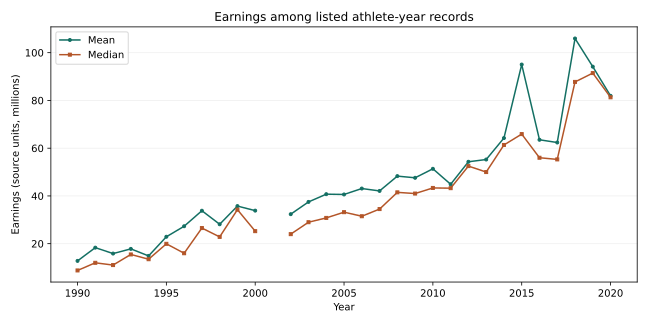

# Athlete Earnings Explorer

Explore earnings, ranking appearances and sport-level patterns in a historical athlete-ranking dataset. The Python workflow validates athlete-year records, creates annual and grouped summaries, and produces a chart with explicit gaps for missing years.



## Features

- Validates required columns, finite numeric values, positive integer ranks, nonnegative earnings and unique athlete-year keys.
- Distinguishes ranking appearances from unique athlete names.
- Exports annual counts, totals, means and medians.
- Summarises appearances and earnings by source sport label and numeric rank.
- Reports missing years, annual record counts and missing previous-year ranks.
- Produces an SVG chart of annual mean and median earnings.
- Provides four automated tests with synthetic fixtures.

## Dataset findings

The supplied file contains **301 athlete-year records**, **82 distinct athlete names** and **30 observed years** between 1990 and 2020. There are no records for 2001. The 2002 list contains 11 records; every other observed year contains 10. The previous-year-rank field has 24 missing values and is not used in the earnings summaries.

Basketball has 81 appearances under that exact source label. Counts represent entries across annual lists, so the same athlete can contribute more than once. The dataset has 20 sport labels, including league names, case variants and combined-sport entries. Labels are retained as supplied, apart from surrounding whitespace, so related categories can appear separately.

## Run

Requires Python 3.10+:

```sh
python -m pip install -r requirements.txt
python -m unittest -v
python analyze.py /path/to/athletes.csv --output output
```

Tests run without the source dataset. Analysis requires an authorised CSV with `name`, `sport`, `year`, `earnings` and `current_rank`. `previous_year_rank` is optional. Numeric fields must contain plain numbers. Outputs at the selected destination are overwritten; use a separate directory to preserve the bundled results.

## Output files

| File | Contents |
|---|---|
| `annual_summary.csv` | Annual appearances, unique names and earnings summaries |
| `sport_summary.csv` | Appearances, unique names and earnings by source sport label |
| `rank_summary.csv` | Appearance counts and earnings by numeric rank |
| `audit.json` | Coverage, missing years and validation information |
| `annual_earnings.svg` | Annual mean and median with missing-year gaps |
| `verification.txt` | Executed test and independent aggregation checks |

## Validation

Four passing test cases cover hand-calculated summaries, numeric rank ordering, invalid records and output generation. Annual counts, totals and means for all 30 observed years also match an independent standard-library CSV calculation. Sport and rank appearance counts each reconcile to the 301 input records.

## Provenance and interpretation

This project draws on `ForbesAnalysis.R` in Derrick Achanga's Posit Cloud project 5536508. Its input file is titled `Forbes Richest Atheletes (1990-2020).csv`. The filename attributes the ranking to Forbes, but the export does not establish the upstream download source, redistribution licence, currency or exact earnings definition. The raw dataset is therefore not bundled. The included results describe that supplied file and are not independently verified Forbes statistics.

The source analysis labels earnings in millions; the chart retains that scale without asserting a currency. Values are not adjusted for inflation. Annual totals refer only to listed records, and changing list composition affects comparisons. The selected top-earner sample does not represent all professional athletes. Name spellings determine unique-athlete counts; the workflow does not perform identity resolution. Rank summaries are descriptive and do not establish that rank causes earnings.

Python implementation, organisation, documentation and verification were prepared with AI assistance. The project demonstrates reproducible exploratory analysis and data-quality reporting.
